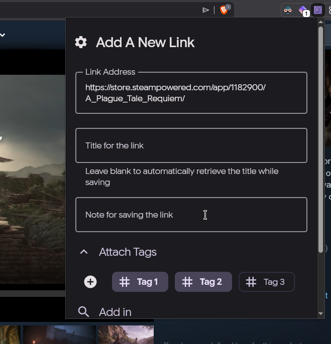
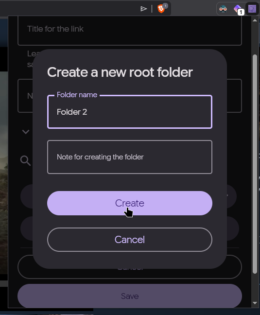
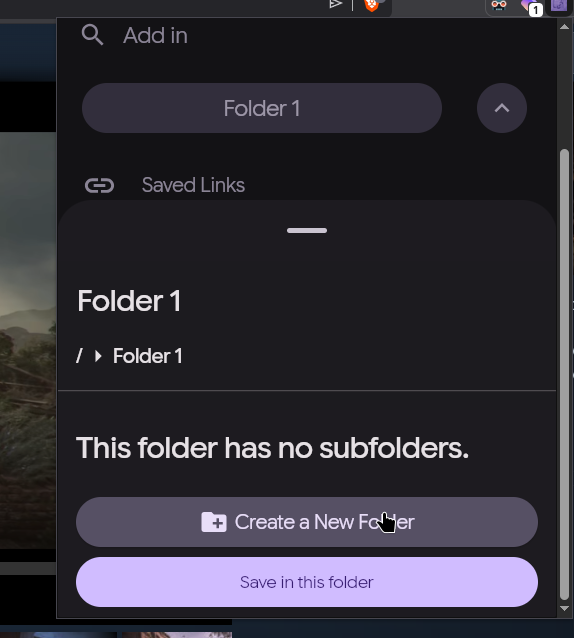
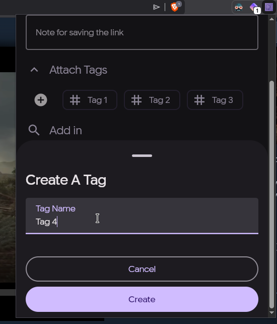

# Linkora Browser Extension

A browser extension that adds "Share from other app" functionality to web browsers. It integrates with your Linkora
Sync-Server to save and sync web page links with metadata.

### Build Locally

```
 ./gradlew :composeApp:wasmJsBrowserDistribution
```

This will create both the standard distribution files and the ZIP file
(in `composeApp/build/extensionDist`) you'll use to install the extension.

### Prerequisites

Ensure your Linkora Sync-Server is running and accessible.

### Installation

The extension is available
on [Firefox Add-ons](https://addons.mozilla.org/en-US/firefox/addon/linkora-browser-extension/).

For Chrome or manual installation:

1. **Download**: Get the latest release (`extension.zip`) from
   the [Linkora Browser Extension Releases](https://github.com/LinkoraApp/browser-extension/releases) page.

2. **Extract**: Unzip the downloaded file to a dedicated folder.

3. **Load Extension**:

   **Chromium-based Browsers** (Chrome, Brave, Edge):
    - Navigate to `chrome://extensions` (or `brave://extensions`, `edge://extensions`).
    - Enable "Developer mode."
    - Click "Load unpacked" and select the extracted folder.

   **Firefox**:
    - Go to `about:debugging#/runtime/this-firefox`.
    - Click "Load Temporary Add-on..." and select `manifest.json` from the extracted folder.
    - *Note*: Firefox requires reloading the extension after each browser restart.

### Configuration

Configure the required information through the extension's settings.

## HTTPS Certificate Setup (Important)

For HTTPS functionality, proper certificate configuration is crucial:

**Chromium-based Browsers**: Import the certificate (`.pem` file) generated by your Sync-Server into your browser's
trusted root certification authorities.

**Firefox**: Go to `about:preferences#privacy` → "View Certificates" → "Servers" and add your server URL with port.

## Compatibility

### Browser Support

**Tested**: Firefox and Brave

## Screenshots

|                   |                   |                   |                   |
|-------------------|-------------------|-------------------|-------------------|
|  |  |  |  |

## Support

**Star the repo** if you find Linkora useful:

[](https://ko-fi.com/sakethpathike)

## License

This extension is licensed under the MIT License.